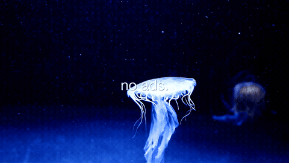
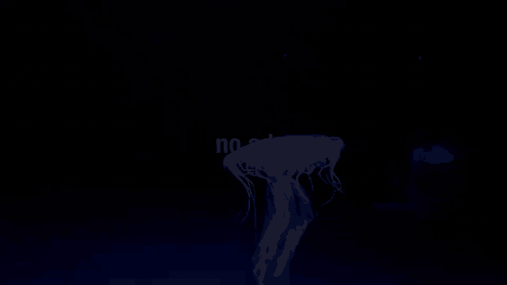

# bumper

A CLI tool for generating [adult swim]-style pre-roll bumper videos for a personal media server. Define bumpers in a YAML config, drop in your own video and music assets, and render MP4s ready to use as pre-rolls via [Tunarr](https://github.com/chrisbenincasa/tunarr) or similar tools.



## Recording (November 2026)



What Adult Swim Bumper looked like in November 2026, recorded for [its page on joekarlsson.com](https://www.joekarlsson.com/work/adult-swim-bumper/). The full-quality video is [2026-11-recording.mp4](.github/readme/2026-11-recording.mp4).

## What it makes

Short MP4 videos (configurable duration, default 10s) with:
- A background video clip (or plain black)
- White text cards cycling one at a time, with a brief gap between them
- Background music that fades in and out
- Your server name in brackets at the end — `[yourserver]` — Adult Swim style

## Requirements

- Python 3.9+
- [ffmpeg](https://ffmpeg.org/download.html) — `brew install ffmpeg` on Mac, `apt install ffmpeg` on Linux

## Quick start

### Install with pipx (recommended)

[pipx](https://pipx.pypa.io/) installs CLI tools in isolated environments — no virtual env setup required.

```bash
# Install pipx if you don't have it
brew install pipx        # macOS
# or: pip install pipx

# Install bumper
pipx install git+https://github.com/joekarlsson/adult-swim-bumper.git

# Create a project directory and initialize
mkdir my-bumpers && cd my-bumpers
bumper init
```

### Or clone and run locally

```bash
git clone https://github.com/joekarlsson/adult-swim-bumper.git
cd adult-swim-bumper
pip install -r requirements.txt
python3 bumper init
```

Then add videos and music (see `samples/*/README.md` for CC0 sources), edit `bumpers.yaml`, and render:

```bash
bumper render
```

Output lands in `output/`.

## Directory structure

```
bumper/
├── bumper               ← the CLI
├── bumpers.yaml         ← your bumper definitions (gitignored, created by init)
├── bumpers.example.yaml ← example bumper config to get started
├── bumper.yaml          ← your server config (gitignored, created by init)
├── videos/              ← your background video clips (.mp4)
├── music/               ← your background music (.mp3 / .flac)
├── output/              ← rendered MP4s land here
└── samples/
    ├── videos/README.md ← CC0 video sources
    └── music/README.md  ← CC0 music sources
```

`videos/`, `music/`, `bumpers.yaml`, and `bumper.yaml` are all gitignored — they're yours, not the repo's.

## Usage

```bash
# First-time setup
python3 bumper init

# List all bumpers and render status
python3 bumper list

# Render all bumpers not yet rendered
python3 bumper render

# Force re-render everything
python3 bumper render --all

# Render one specific bumper by name
python3 bumper render sit-back

# Interactively add a new bumper
python3 bumper add

# List available video and music assets
python3 bumper assets

# Open the output folder
python3 bumper open
```

You can also make the CLI directly executable:

```bash
chmod +x bumper
./bumper list
```

## Defining bumpers

`bumpers.yaml` (created by `bumper init` from `bumpers.example.yaml`):

```yaml
- name: sit-back
  cards:
    - "sit back."
    - "breathe."
    - "it's just a movie."
  video: videos/ocean.mp4
  music: music/lofi-jazz.mp3

- name: no-ads
  cards:
    - "no ads."
    - "no algorithm."
    - "no idea what you should watch."
  video: null
  music: music/ambient.mp3
```

Each bumper:
- `name` — unique slug, used in the output filename
- `cards` — 2–4 lines of text shown one at a time (`[yourserver]` always appended as the final card)
- `video` — path to a background clip relative to this directory, or `null` for plain black
- `music` — path to a music file relative to this directory
- `duration` — optional, overrides the project default for this bumper only (e.g. `duration: 15`)

Output filename: `output/{servername}-bumper-{name}.mp4`

## Configuration

Set during `bumper init`, stored in `bumper.yaml`. All fields are optional — defaults are shown:

```yaml
server_name: yourserver
duration: 10              # default bumper length in seconds
font_size: 96             # text size in pixels
resolution: [1920, 1080]  # output width × height
font_path: /path/to/font.ttf  # optional: use a specific font file
```

`font_path` accepts any `.ttf` or `.ttc` file. If omitted, bumper auto-detects Helvetica Neue (macOS), DejaVu Sans (Linux), or Arial (Windows).

Duration can also be overridden per-bumper in `bumpers.yaml`, or at render time:

```bash
bumper render --duration 15            # override for this run only
bumper render sit-back --duration 8   # one specific bumper
```

Priority order: `--duration` flag > per-bumper `duration:` field > `bumper.yaml` default > 10s fallback.

## Finding free assets

See `samples/videos/README.md` and `samples/music/README.md` for curated CC0 sources.

**Videos (CC0):** [Mixkit](https://mixkit.co/free-stock-video/), [Pexels](https://www.pexels.com/videos/), [Pixabay](https://pixabay.com/videos/)

**Music (CC0):** [Internet Archive — Loyalty Freak Music](https://archive.org/search?query=loyalty+freak+music), [Free Music Archive](https://freemusicarchive.org/) (filter CC0), [Pixabay Music](https://pixabay.com/music/)

## Render settings

Most settings live in `bumper.yaml` (see Configuration above). The remaining low-level constants are at the top of `adult_swim_bumper/cli.py`:

| Setting | Default | Description |
|---------|---------|-------------|
| `FPS` | 30 | Frames per second |
| `CARD_GAP` | 0.2 | Blank gap between cards (seconds) |

## Adding to Plex via Tunarr

1. Render your bumpers: `python3 bumper render`
2. Copy the `output/` folder to your media server
3. In Tunarr, add the bumper files as pre-roll content for your movie channel

## License

MIT — do whatever you want with it.
